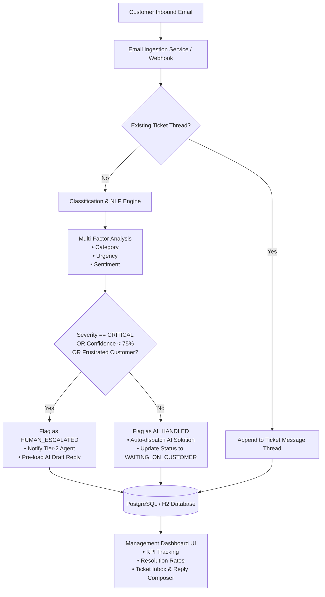

# Automated Customer Support Desk 🚀
### Production-Grade Email-to-Ticket Microservice & Management Dashboard

[](https://www.oracle.com/java/)
[](https://spring.io/projects/spring-boot)
[](https://spring.io/projects/spring-security)
[](https://www.docker.com/)
[](LICENSE)

An intelligent, event-driven customer support microservice that automatically ingests incoming customer emails, performs multi-factor NLP and keyword classification for urgency and category, generates contextual AI draft replies, and provides a management dashboard to monitor resolution rates and separate AI-handled tickets from human escalations.

---

## 🌟 Key Features

1. **Email-to-Ticket Ingestion Engine**
   - Ingests inbound customer emails via REST webhooks or scheduled IMAP mailbox pollers.
   - Parses RFC822 metadata, subjects, threads, sender details, and message bodies.
   - Detects incoming replies to existing tickets (`Re: [TICK-...]`) and appends them to historical conversation threads.

2. **Intelligent Classification & Urgency Engine**
   - **Topic/Category Detection:** `BILLING`, `TECHNICAL_SUPPORT`, `ACCOUNT_ACCESS`, `SECURITY`, `FEATURE_REQUEST`, `GENERAL_INQUIRY`.
   - **Urgency Scoring:** `CRITICAL` (Production down / SLA outage), `HIGH`, `MEDIUM`, `LOW`.
   - **Sentiment & Frustration Detection:** Flags angry or frustrated sentiment and automatically triggers human escalation to senior agents.
   - **AI Confidence Scoring:** Calculates precision confidence (0.0 - 1.0) and routes tickets below the autonomy threshold for human review.

3. **Smart Auto-Reply & Contextual Drafting**
   - Instantly generates tailored, professional, empathetic solutions based on detected category and customer context.
   - **AI-Handled Mode:** Directly resolves common self-serve issues (password resets, invoice retrieval, FAQs).
   - **Human Escalated Mode:** Pre-drafts a recommended agent response ready for one-click approval or manual edit.

4. **Interactive Management Dashboard**
   - Real-time KPI cards: **Total Tickets**, **Resolution Rate %**, **AI Autonomy %**, **Human Escalations**, **Average Response Time**.
   - Filter tickets by Handling Type (`AI-Handled` vs `Human Escalations`), Status, Urgency, and Category.
   - Detailed Ticket Modal with conversation thread, AI confidence meter, and agent reply composer.
   - Built-in **Inbound Email Simulator** with 1-click test presets (Production Outage, Password Reset, Billing Issue, Feature Request).

5. **Enterprise Security & Role-Based Access Control (RBAC)**
   - Stateless authentication powered by Spring Security 6 and HMAC-SHA256 JWT tokens.
   - Fine-grained role hierarchy: `ROLE_ADMIN`, `ROLE_AGENT`, `ROLE_CUSTOMER`.

---

## 🏗️ Architecture



---

## 🛠️ Tech Stack & Resume Highlights

| Layer | Technology |
|---|---|
| **Language & Framework** | Java 21 LTS, Spring Boot 3.5.5 |
| **Persistence** | Spring Data JPA, Hibernate, H2 (In-Memory Dev), PostgreSQL 16 (Production) |
| **Security & Auth** | Spring Security 6, JJWT (HMAC-SHA256), Role-Based Access Control (RBAC) |
| **Communication** | Spring Mail (`JavaMailSender`), MailHog (Local SMTP testing) |
| **API & Documentation** | Spring Web MVC, SpringDoc OpenAPI 3, Swagger UI (`/swagger-ui.html`) |
| **Testing** | JUnit 5, Mockito, AssertJ, SpringBootTest, MockMvc |
| **DevOps & Containerization** | Docker (Multi-stage build), Docker Compose, GitHub Actions CI Pipeline |
| **Frontend Architecture** | React 18, Vite 5, Tailwind CSS, Lucide React, Nginx Reverse Proxy |

---

## 🚀 Quickstart Guide

### Prerequisites
- Java 21 LTS
- Maven 3.9+ (or use the included `./mvnw`)
- Docker & Docker Compose *(optional, for containerized run)*

### Option A: Local Run (Zero Configuration / In-Memory H2)
Clone the repository and run:
```bash
./mvnw clean spring-boot:run
```
The application will start on **`http://localhost:8080`**.
- **Management Dashboard:** [http://localhost:8080/](http://localhost:8080/) *(Pre-bundled React 18 SPA served directly by Spring Boot)*
- **Swagger OpenAPI Documentation:** [http://localhost:8080/swagger-ui.html](http://localhost:8080/swagger-ui.html)
- **H2 Database Console:** [http://localhost:8080/h2-console](http://localhost:8080/h2-console) *(JDBC URL: `jdbc:h2:mem:supportdeskdb`, User: `sa`, Password: empty)*

### Option B: Frontend Hot-Reload Development (Vite Dev Server)
To work on the React UI with instant Hot Module Replacement (HMR):
```bash
cd frontend
npm install
npm run dev
```
Runs the Vite development server on **`http://localhost:3000`** with automatic reverse proxy to `http://localhost:8080/api`.

### Option C: Docker Compose (Spring Boot + PostgreSQL + MailHog + React UI)
```bash
docker compose up --build
```
Services spun up:
- **Support Desk React UI:** `http://localhost:3000`
- **Support Desk Backend API:** `http://localhost:8080`
- **PostgreSQL Database:** `localhost:5432`
- **MailHog Web Mailbox:** `http://localhost:8025` *(view all dispatched test emails)*

---

## 🔑 Pre-seeded Demo Credentials

| Role | Email | Password | Permissions |
|---|---|---|---|
| **Admin** | `admin@supportdesk.io` | `Admin@123` | Full access, KPI metrics, user management, agent reassignment |
| **Support Agent** | `agent.sarah@supportdesk.io` | `Agent@123` | Inspect tickets, approve AI drafts, reply, resolve cases |
| **Customer** | `david@acmecorp.com` | `Customer@123` | View customer tickets |

---

## 📡 REST API Reference

### 1. Inbound Email Webhook
- `POST /api/v1/emails/ingest`: Ingest customer message from mail gateway.
- `POST /api/v1/emails/simulate`: Instant interactive simulation endpoint.

**Request Payload:**
```json
{
  "senderName": "Alex Rivera",
  "senderEmail": "devops@fintech.com",
  "subject": "URGENT: Production API down with 500 error",
  "body": "Our payment webhook is failing immediately with 500 internal server error. All client transactions are blocked!"
}
```

### 2. Tickets Management
- `GET /api/v1/tickets?status=NEW&urgency=CRITICAL&handlingType=HUMAN_ESCALATED&search=payment`
- `GET /api/v1/tickets/{id}`: Detailed conversation history and AI draft reply.
- `PATCH /api/v1/tickets/{id}/status`: Transition ticket state (`NEW`, `IN_PROGRESS`, `WAITING_ON_CUSTOMER`, `RESOLVED`, `CLOSED`).
- `POST /api/v1/tickets/{id}/assign`: Assign case to an agent.
- `POST /api/v1/tickets/{id}/escalate`: Manually route ticket to tier-2 engineers.
- `POST /api/v1/tickets/{id}/reply`: Send agent response to customer.
- `POST /api/v1/tickets/{id}/approve-draft`: Approve AI pre-drafted reply and send.

### 3. Dashboard Analytics
- `GET /api/v1/dashboard/metrics`: Resolution rates %, AI autonomy %, average resolution times, and category breakdown.
- `GET /api/v1/dashboard/recent-activity`: Real-time recent event stream.

---

## 🧪 Running Automated Tests

Run the test suite with coverage:
```bash
./mvnw clean test
```

Test coverage includes:
- `ClassificationServiceTest`: Verifies NLP rules, urgency detection, sentiment analysis, and autonomous threshold gating.
- `EmailIngestionServiceTest`: Tests new ticket ingestion, automated AI reply dispatch, and threaded customer replies.
- `TicketControllerIntegrationTest`: Full HTTP integration tests using `MockMvc` for endpoints, validation, and JWT security.
- `DashboardServiceTest`: Verifies KPI accuracy and math for resolution and autonomy rates.

---

## 📄 License
This project is licensed under the Apache 2.0 License.
